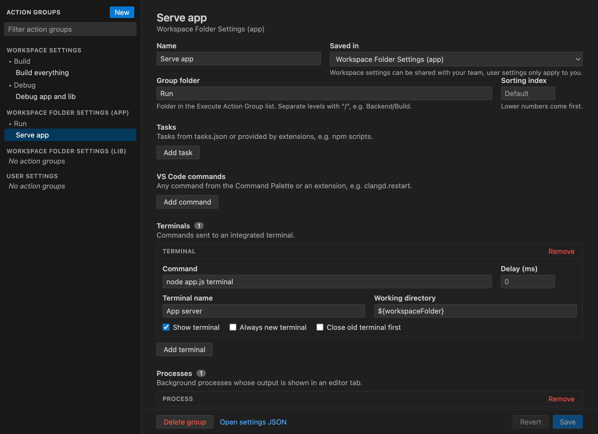
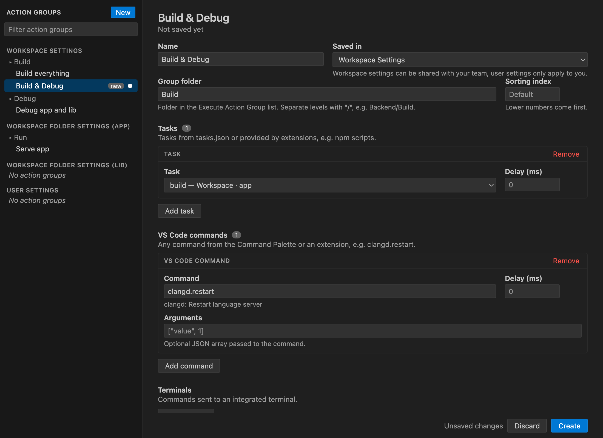
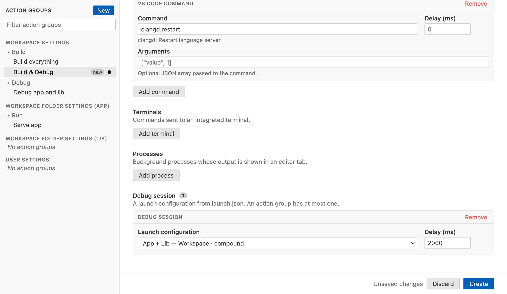

# Action Group Executer

Start everything you need for a workflow with one shortcut. An action group combines VS Code tasks, VS Code commands, terminals, background processes and a debug session, and starts them all together.



## Quick start

1. Run `ActionGroupExec: Create Action Group` from the Command Palette.
2. Give the group a name and add actions, e.g. your `build` task and the `clangd.restart` command, then click **Create**.
3. Press `Ctrl+Shift+A` / `Cmd+Shift+A` (`ActionGroupExec: Execute Action Group`) and pick the group.

## Commands

| Command | Description |
|---|---|
| `ActionGroupExec: Execute Action Group` | Pick an action group and start all of its actions. Default keybinding `Ctrl+Shift+A` / `Cmd+Shift+A`. |
| `ActionGroupExec: Edit Action Groups` | Open the action group editor. |
| `ActionGroupExec: Create Action Group` | Open the action group editor with a new group. |
| `ActionGroupExec: Select a current Background Process and Control It` | Send input or kill signals to a running background process. |
| `ActionGroupExec: Send a Text Message to the current Background Process` | Send text to the process of the active output tab. |
| `ActionGroupExec: Kill current Background Process` | Kill the process of the active output tab. |
| `ActionGroupExec: Kill all Background Processes` | Kill all background processes. |

## The action group editor

`ActionGroupExec: Edit Action Groups` opens an editor tab for all action groups. The left side lists the groups of all settings locations (workspace, workspace folders and user settings) sorted by group folder. The right side shows the selected group as a form.



* **Tasks** and **debug sessions** are selected from the tasks and launch configurations of your workspace, including npm scripts and tasks of other extensions.
* **VS Code commands** can be searched by ID or title, e.g. `clangd.restart`.
* **Terminals** and **processes** are entered as command lines, with name, working directory and delay.
* **Saved in** decides where the group is stored. Workspace settings can be shared with your team, user settings apply to all your workspaces. Changing it moves the group.



Unsaved changes are kept per group while you switch between groups and marked with ●. Save with the button or `Ctrl+S` / `Cmd+S`. If the settings were changed elsewhere in the meantime, the editor doesn't overwrite them.

Saving rewrites the `actionGroupExecuter.actionGroups` setting, so comments inside it are lost. Options the editor doesn't show, e.g. environment variables, are kept. Processes with sequential `commands` and inline debug configurations (`newConfiguration`) can only be removed in the editor, edit them in the settings JSON.

## Configuring action groups in the settings

Action groups are stored in the `actionGroupExecuter.actionGroups` setting, which you can also edit directly in the settings JSON. Every group needs a `name` and at least one action:

```jsonc
"actionGroupExecuter.actionGroups": [
    {
        "name": "Build and run",
        "tasks": [{ "name": "build" }],
        "terminals": [{ "command": "npm start" }]
    }
]
```

| Option | Description |
|---|---|
| `name` | Name shown in the `Execute Action Group` list. Required. |
| `tasks` | [VS Code tasks](#tasks) to start. |
| `commands` | [VS Code commands](#vs-code-commands) to execute. |
| `terminals` | [Terminals](#terminals) to send commands to. |
| `processes` | [Background processes](#processes) with their output in an editor tab. |
| `debugSession` | A [debug session](#debug-sessions) to start. |
| `groupNames` | [Group folders](#group-folders-and-order) the group is shown in. |
| `sortingIndex` | [Position](#group-folders-and-order) in the list, lower numbers come first. |
| `defaultProcessDebugTemplate` | Launch configuration template to [debug processes and terminals](#debugging-processes-and-terminals). |

All actions of a group start at the same time. Use the delay options to start an action later, e.g. a debug session after a server is up.

### Tasks

Start tasks from `tasks.json` or tasks provided by extensions, e.g. npm scripts. Tasks are found by their name (label).

```jsonc
"tasks": [
    { "name": "build" },
    { "name": "watch", "source": "npm", "workspaceName": "app", "delayTask": 2000 }
]
```

| Option | Description |
|---|---|
| `name` | Name (label) of the task. Required. |
| `source` | Only use a task of this source, e.g. `Workspace` for `tasks.json` or `npm` for npm scripts. |
| `workspaceName` | Workspace folder of the task in multi-root workspaces. By default the folder of the current file is preferred. |
| `delayTask` | Start delay in ms. |

### VS Code commands

Execute any command from the Command Palette or an extension by its ID. You can copy the ID with "Copy Command ID" in the context menu of the Keyboard Shortcuts editor.

```jsonc
"commands": [
    { "id": "workbench.action.files.saveAll" },
    { "id": "clangd.restart", "delayCommand": 500 },
    { "id": "workbench.action.quickOpen", "args": ["${fileBasename}"] }
]
```

| Option | Description |
|---|---|
| `id` | ID of the command. Required. |
| `args` | Arguments passed to the command. |
| `delayCommand` | Start delay in ms. |

### Terminals

Send a command to an integrated terminal. The terminal is reused when one with the same name exists.

```jsonc
"terminals": [
    { "command": "npm start" },
    {
        "name": "Logs",
        "command": "tail -f server.log",
        "delayCommand": 5000,
        "disposeOldTerminal": true,
        "extendedOptions": { "cwd": "${workspaceFolder}/logs" }
    }
]
```

| Option | Description |
|---|---|
| `command` | Command sent to the terminal. Required. |
| `name` | Name of the terminal. Defaults to the action group name. |
| `showTerminal` | Show the terminal. Default `true`. |
| `alwaysNewTerminal` | Create a new terminal even if one with the name exists, e.g. "Logs (1)". |
| `disposeOldTerminal` | Close an existing terminal with the name first. |
| `delayCommand` | Delay in ms before the command is sent. |
| `extendedOptions` | [VS Code TerminalOptions](https://code.visualstudio.com/api/references/vscode-api#TerminalOptions), e.g. `cwd`, `env` or `shellPath`. Close old terminals after changing them. |
| `debugTemplate`, `useProcessDefaultDebugConfig` | See [debugging processes and terminals](#debugging-processes-and-terminals). |

A terminal runs one command line. To run several commands, combine them, e.g. `echo Hello1 && sleep 10 && echo Hello2`.

### Processes

Run a program in the background and show its output in an editor tab. Program and arguments are separate strings, so no quoting is needed.

```jsonc
"processes": [
    {
        "name": "List home",
        "command": {
            "call": ["ls", "-la", "${env:HOME}"],
            "extendedOptions": { "cwd": "${workspaceFolder}", "env": { "LANG": "C" } }
        }
    }
]
```

Every entry of `processes` gets its own output tab, so several entries run in parallel. To run commands one after another in the same tab, use `commands` instead of `command`:

```jsonc
"processes": [
    {
        "printCommand": true,
        "commands": [
            { "call": ["npm", "ci"], "processEndMessage": "\nInstalled.\n" },
            { "call": ["npm", "test"], "processEndMessage": "\nTests ended with ${returnCode}.\n" }
        ]
    }
]
```

| Option | Description |
|---|---|
| `command` / `commands` | One command, or a list of commands that run one after another. One of them is required. |
| `name` | Name printed at the top of the output tab. |
| `printName` | Print the name. Default `true` when a name is set. |
| `printCommand` | Print each command before it runs. |
| `fileAssociation` | Language of the output tab, e.g. `log`. Defaults to `actionGroupExecuter.defaultFileAssociation`. |

Options of each command:

| Option | Description |
|---|---|
| `call` | Program and arguments as separate strings. Required. |
| `delayProcess` | Start delay in ms. |
| `requestUserInputArguments` | Ask for additional arguments when the group is started, e.g. a test filter. Recent inputs are offered again. |
| `processEndMessage` | Message printed when the process ends. `${returnCode}` is replaced with the exit code. Defaults to `actionGroupExecuter.defaultProcessEndMessage`. |
| `hideProcessEndMessage` | Don't print the end message. |
| `extendedOptions` | Node.js [spawn options](https://nodejs.org/api/child_process.html#child_processspawncommand-args-options), e.g. `cwd`, `env`, `shell` or `timeout`. |
| `debugTemplate` | See [debugging processes and terminals](#debugging-processes-and-terminals). |

Environment variables like `$HOME` are not resolved in `call`, use `${env:HOME}` instead.

### Debug sessions

Start a launch configuration by its name, or define one inline.

```jsonc
"debugSession": {
    "namedConfiguration": "Run app",
    "workspaceName": "app",
    "delaySession": 2000
}
```

```jsonc
"debugSession": {
    "newConfiguration": {
        "name": "Debug current file",
        "type": "python",
        "request": "launch",
        "program": "${file}",
        "args": []
    },
    "requestUserInputArguments": true
}
```

| Option | Description |
|---|---|
| `namedConfiguration` | Name of a launch configuration or compound in `launch.json`. |
| `newConfiguration` | An inline launch configuration. |
| `workspaceName` | Workspace folder of the launch configuration in multi-root workspaces. By default the folder of the current file. |
| `requestUserInputArguments` | Ask for additional arguments, which are appended to the `args` of `newConfiguration`. |
| `delaySession` | Start delay in ms. |

### Debugging processes and terminals

Processes and terminals can also be started in the debugger instead. When a group contains such actions, `Execute Action Group` asks which one to debug, or none.

```jsonc
{
    "name": "Run scripts",
    "processes": [
        // Uses defaultProcessDebugTemplate.
        { "name": "Script 1", "command": { "call": ["./script1.py", "--verbose"] } },
        {
            "name": "Script 2",
            "command": {
                "call": ["./script2.py"],
                // Takes priority over defaultProcessDebugTemplate.
                "debugTemplate": { "type": "python", "request": "launch", "justMyCode": false }
            }
        }
    ],
    "terminals": [
        { "name": "Script 3", "command": "./script3.py", "useProcessDefaultDebugConfig": true }
    ],
    "defaultProcessDebugTemplate": { "type": "python", "request": "launch", "console": "integratedTerminal" }
}
```

The program, arguments and working directory of the selected action are added to the template. A process is debuggable when it has a single `command` and a `debugTemplate` or `defaultProcessDebugTemplate`. A terminal is debuggable with a `debugTemplate`, or with `useProcessDefaultDebugConfig` and a `defaultProcessDebugTemplate`. Groups with a `debugSession` don't ask.

### Group folders and order

`groupNames` shows a group inside folders of the `Execute Action Group` list, like directories. `sortingIndex` orders groups and folders, lower numbers come first.

```jsonc
[
    {
        "name": "Start server",
        "groupNames": [{ "name": "Backend", "sortingIndex": 1 }],
        "terminals": [{ "command": "npm run server" }]
    },
    {
        "name": "Run integration tests",
        "groupNames": [{ "name": "Backend" }, { "name": "Tests" }],
        "sortingIndex": 2,
        "tasks": [{ "name": "integration-tests" }]
    }
]
```

## Variables

All strings can use these [VS Code predefined variables](https://code.visualstudio.com/docs/editor/variables-reference): `${cwd}`, `${fileBasenameNoExtensions}`, `${fileBasename}`, `${fileDirname}`, `${fileExtname}`, `${file}`, `${lineNumber}`, `${pathSeparator}`, `${relativeFileDirname}`, `${relativeFile}`, `${selectedText}`, `${workspaceFolderBasename}` and `${workspaceFolder}`. `${env:NAME}` is replaced with the environment variable `NAME`.

The file variables refer to the active editor. When a non-text tab is active, e.g. an image or SVG preview, they refer to the file of that tab.

The `newConfiguration` of debug sessions and the `extendedOptions` of terminals support all [VS Code predefined variables](https://code.visualstudio.com/docs/editor/variables-reference).

## Extension settings

| Setting | Description |
|---|---|
| `actionGroupExecuter.actionGroups` | List of action groups, see [above](#configuring-action-groups-in-the-settings). |
| `actionGroupExecuter.defaultProcessEndMessage` | Message added to process output tabs when a process ends. Supports `${returnCode}`. |
| `actionGroupExecuter.defaultFileAssociation` | Language of process output tabs, e.g. `plaintext` or `log`. |
| `actionGroupExecuter.defaultShowActionSource` | Show the settings location (user, workspace) next to the group names in the `Execute Action Group` list. Default `true`. |

## Known issues

* Running processes are not restored when a window is closed.
* Process output tabs are created with a 500 ms delay, otherwise VS Code fails to create the next tab.
* When starting a debugger, VS Code asks to save the current file.
* When a process is debugged, its output goes to the debug console instead of an output tab.
* Sequential process `commands` don't check the exit code of the previous command.
* Additional arguments entered for `requestUserInputArguments` are not validated.

## Release notes

See [CHANGELOG.md](CHANGELOG.md).
